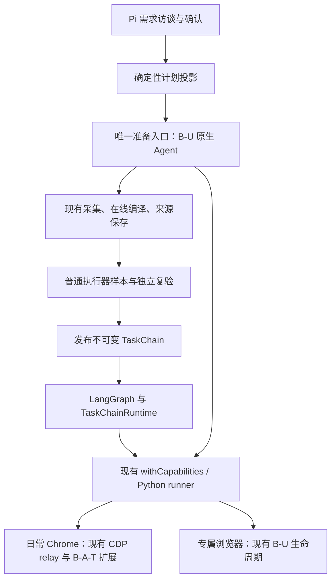

# B-A-T：移除 BSK 与清理废弃探索路径

日期：2026-10-12。入场状态：开发方案，尚未实施。

同日实施补注：A1/A2已按既有受管能力承接和清理；原替代Chrome验收已撤回。纠正入口、CDP错误结构及取消归属恢复后，新冻结1234文件的taskd246fdb8完成需求→准备→发布→同版变化输入正式复跑，四次Human/39 clear、普通模型0、首次清理confirmed，见[最终报告](PRODUCT_BROWSER_FINAL_REPORT_20261012.md)。三项任务总交付仍有Mac/重启实测缺口，尚未提交推送；最新用户要求完成后也不关机。下文保留原方案与验收条件。

本方案只负责两件事：①彻底移除 B-A-T 对外部 BSK 的依赖及旧执行实现；②删除已经被当前主线替代的探索分支。用户随后追加的盾双平台部署另见 [独立部署方案](SHIELD_WINDOWS_MAC_DEPLOYMENT_PLAN_20261012.md)，不得混入本次 B-A-T 改动。

## 1. 目标、范围与完成定义

### 1.1 “彻底移除 BSK”的准确含义

- B-A-T 安装、启动、需求对话、准备、试跑、发布、复跑、恢复、取消、清理均不调用或探测外部 `bsk` / `bsk.exe`，不连接 BrowserSkill daemon，不要求官方 BrowserSkill 扩展。
- 不借用另一项目的安装目录、全局 PATH、`BSK_HOME`、命名管道、后台进程或配置；不以随包附带 bsk.exe、自动下载安装、改名包装 CLI 达成“独立”。
- 删除 BSK 专有的命令传输、会话控制、备用执行选择和已失效配置。仍需的浏览器能力接入现有 browser-use 运行通道，不能直接消失。
- 当前已经纳入 B-A-T 扩展源码的 `WSTransport`、heartbeat、keepalive 是固定版本开源组件，随扩展构建，无 BSK 进程/安装依赖；继续复用并保留许可证和来源摘要，不为了消除 BrowserSkill 字样重写连接组件。
- 历史文档、许可证、来源清单、必要的旧数据解码和“禁止外部 BSK 调用”的回归断言可保留相关名称。验收看运行依赖和执行路径，不能以全仓关键词零命中代替。
- 本任务不卸载用户电脑上的独立 BrowserSkill、不删除全局安装或其他扩展、不修改相邻项目。

### 1.2 “清理废弃探索”的完成定义

准备任务只保留现有 B-U 原生探索 → 原采集 → 在线编译/来源保存 → 普通执行器验证这一条生产路径。旧 Pi 浏览器探索、business-only 预执行、逐步预执行及其专属轨迹编译入口退出生产代码和测试入口。

需求访谈使用的 Pi AgentSession、来源离线恢复、同一探索中的在线编译、显式修复、人工接管和正式图执行不是多余探索，必须保留。不能按文件名中的 `exploration`、`legacy`、`v2` 或 CodeGraph 的零调用结果机械删除。

### 1.3 范围边界

- 不重做访谈、结果合同、输入策略、节点模型、画布、账号产品、访问治理或检测盾。
- 不删除 LangGraph，不自建调度器、Agent loop、浏览器控制器或新的连接网关。
- 本阶段不改盾，也不重跑盾检测作为这两项工作的必要前置；使用本地通用样本验证 B-A-T。
- 保留不可变发布版本、历史运行、首次失败和已关闭/未关闭资源事实。不把仍可运行的旧任务统一改成只读或要求用户重新创建。
- 新发现的无关问题记录原因、影响、证据，不顺手修复。移除依赖直接引发的合同、装配、历史读取或清理回归属于本任务必须解决的范围。
- 不创建 worktree，不使用其他模型覆盖，不访问京东，不自动关机；本方案不授予提交或推送权限。

## 2. 当前核验基线与事实

本轮实际 checkout：`D:\work\browser-auto-tool`，`master@94fb77d9c04803ebee608814ee20b09fb545c230`；文档编辑前工作区干净。路径是本机快照，开发命令的 workdir 必须使用下一 session 实際核验的 checkout，不能写死本机路径为产品要求。

本轮没有启动/关闭服务、浏览器或 BSK，没有执行产品测试、修改数据库、读取 Cookie 或安装依赖。下面的结构来自现行源码；过去的通过记录只作基线，不是本次删除后的证明。

已有新任务通过记录见 [后台连接与主流程结算](BAT_BACKGROUND_CONNECTION_AND_MAINFLOW_20261012.md)：新任务 `c52e7dc3`、正式运行 `43e68dd4`。本轮未复测，不将过去的通过解释为全部旧能力已经迁移。历史 Chrome 三项其他扩展损坏禁用问题仍另案保留，本次不修。

### 2.1 已确认仍存在的 BSK 路径

| 入口 | 实际作用 | 开发处理 |
| --- | --- | --- |
| `packages/browser/src/transport.ts`：`bskExecutor` | Windows 启动 `bsk.exe`，其他平台启动 `bsk`；依赖 PATH | 删除外部进程执行器及专属超时/输出协议 |
| `apps/api/src/app.ts` | 默认构造 `BrowserService(..., bskExecutor(root), ...)`；另有 `browserExecutor` 测试注入 | 删除 BSK 装配；调整仍有效的服务依赖及测试注入 |
| `packages/browser/src/index.ts`：`BrowserHost` | BSK session start/stop、owner、finally、恢复清理 | 迁移仍需生命周期语义后删除旧控制实现 |
| `packages/browser/src/session.ts` 及专属 helpers | 将动作、观察、标签页、人工帮助等转换为 BSK 命令 | 不整体复制到新目录；用成熟当前能力承接 |
| `apps/api/src/task-chain/runtime-host.ts`：`group` | hybrid 链走 `upstream.withCapabilities`；另一分支走 `BrowserService.run` 与 `TaskChainBrowserAdapter` | 合并到一个浏览器运行后端；纯数据链仍无需打开浏览器 |
| `packages/browser/src/task-chain-adapter.ts` | 旧 browser/observe/human 节点及 `browser.perform@1` 合同适配 | 分清可保留的 IR 映射与应删除的 BSK 控制逻辑 |
| `apps/api/src/task-chain/capability-descriptors.ts` | `browser.perform@1` 仍在产品描述注册表中 | 不能因主线生成新版节点就推断旧入口没人用 |
| `apps/api/src/browser/service.ts`、`app.ts` 的 `/api/browser` | 状态、取消、清理、旧运行持久化与空闲校验 | 核对 UI/HTTP 消费者；保留必要读取/保护，删除 BSK 执行 |
| `apps/api/src/task-deletion.ts` | 读取 BrowserJournal、保护未关闭 owner、清理任务私有历史 | 保留归属门和历史可读性，不能简单删掉忙碌保护 |
| `preparation-plan-projection.ts` | 从旧 browser 包导入 `browserGrantLimits` | 通用预算移至现有合适公共层，数值/含义不变 |

构造 `bskExecutor` 不等于当场启动 BSK；真正执行该函数返回的命令入口才会创建子进程。不得把新主线已不走 BSK 误写为全产品已独立。

根 `scripts/setup.mjs` 和 `scripts/setup-upstream-browser-runner.mjs` 已管理 uv/Python/browser-use；并未解决上述外部 BSK 的安装契约。这是删除隐式依赖的直接原因。

### 2.2 探索分支清单

| 路径 | 当前证据 | 目标 |
| --- | --- | --- |
| `TaskChainAuthoring.explorePlan` → `upstream.withAuthoring` → `withHybridAuthoring` | 当前生产准备路径；带来源与在线编译回调 | 保留，作为唯一生产浏览器探索 |
| `TaskRuntimeHost.explore` → `runExplorationAgent` | 仍有旧 browser 工具、complete/complete_step、continuation、模型升级等代码；预算测试直接调用 | 核完生产/反射/导出引用后删除旧入口和专属实现；有效预算断言迁到当前路径 |
| `TaskRuntimeHost.preexecuteBusinessOnly` → `runBusinessPreexecution` | 旧 business-only 预执行实现仍在 | 删除该独立探索路径和专属 DTO/测试 |
| `TaskRuntimeHost.preexecutePlan` → `runPlannedPreexecution` | 逐步建立旧模型预执行的入口仍在 | 删除该独立路径，不能留作失败后后备 |
| `trace-compiler.ts` + `compilation-annotations.ts` | 旧 ExplorationTrace 编译体系；现有专属测试直接导入 | 核对消费者后删除整套旧编译分支 |
| `UpstreamBrowserRuntime.withSession` / `PythonUpstreamBrowserRuntime.withSession` | 旧 workflow-use-v1 接口，实际实现调用退休错误 | 清理无执行用途的接口和桩；历史数据的明确退休诊断可保留 |
| `recompileHybridSource`、来源复用、`bat-hybrid/2` 的离线补注解 | 当前仍有按来源版本调用的兼容分支；不是已证明废弃 | 保留必要兼容；`bat-hybrid/3` 不得误入旧补注解、重复调用模型 |

CodeGraph 在此次 `explorePlan → withAuthoring` 动态分派上返回未找到直接路径；方法体有实际调用。删除依据必须是生产入口、引用/注册、持久合同与必要测试的闭合关系，不能只看静态图“无 callers”。

## 3. 目标架构与职责承接



两种浏览器环境是同一执行能力的环境选择，不是两条探索实现。旧节点合同只允许有薄的确定性适配，最终进入同一个受控会话。

### 3.1 BSK 原职责逐项承接

| 原职责/不变量 | 承接现有位置 | 必须核对的差异 |
| --- | --- | --- |
| 请求与结果传输 | `upstream-browser/service.ts` 的 RunnerProcess、现有 hybrid 协议 | Zod 边界、取消、超时、异常原始原因和结果字段 |
| 后台连接、保活、重连 | `daily-extension.ts`、`daily-extension-background.ts`、扩展 `backgroundConnection.ts`、原 Playwright relay | 无连接 tab；首授、暂停、撤销不可被重连覆盖 |
| 浏览器动作与目标解析 | `hybrid-runtime.ts`、Python `task_browser.py`、既有 B-U Tools/Actor | 原定位语义、目标身份、frame/新标签、动作回执；不写第二份解析器 |
| 观察、DOM 读取与结果投影 | 当前 read-fields/观察和来源绑定链 | 旧 page/read/capture 的返回形状不能直接用新版结果冒充 |
| 会话/窗口归属、单次运行 | `python-runtime.ts`、`task-connection.ts`、managed window/lease/target scope | 一次运行一个实际控制会话；不因旧节点再开第二会话 |
| 人工帮助、暂停与恢复 | 当前 human handlers、waitpoint 与 verifyResume | 等待时不消耗活动预算；恢复身份核验、取消和外部访问限制保留 |
| 预算、访问边界、审计 | TaskBudgetLedger、原访问治理、runtime 审计 | 原命令/活动时间核算不丢失；普通复跑无隐式模型 |
| 关闭与失败恢复 | 现有 runner cleanup、execution cleanup recovery、owner/lease | TaskRun 结果和清理状态分开；不能吞原业务错误或伪报 confirmed |
| 旧历史、删除保护 | 现有 store/repository + 最小旧记录解析 | 旧 ID/摘要/失败不改写；未核验 owner 不能随删除入口被抹掉 |

当前 `withCapabilities` 主要提供新版 capability 通道，**并非已经自动兼容所有旧 browser/observe/human 节点**。这项适配是开发工作，不能在文档或提交说明中写成现成能力。

### 3.2 旧任务与能力兼容规则

1. 开发先列出旧公开合同中真实支持的动作和输出，再只读统计现存发布链的节点/能力版本；输出计数和 ID 摘要，不输出页面数据、账号或任务正文。
2. 覆盖 navigate、click、hover、fill、press、select、scroll、wait、tabs、observe/read、人机等待、恢复；upload/download 按旧实际支持合同逐项核对。旧实现明确不支持的 drag 不因此新增支持，也不能从“枚举中存在”推断已支持。
3. 对仍支持的旧 IR，优先在现有 runtime 适配层将已解析参数交给现有原生能力，并按旧合同投影输出。身份/来源不足不能改用盲点选或临时模型猜测。
4. 适配只拥有 B-A-T 合同映射；不得保留 BSK 命令字符串、命名管道、CLI session ID 或整套 BrowserSession 状态机，更不能把旧实现改名后搬过去。
5. 旧发布链原字节、ID、版本和摘要保持。新执行记录可以记录所用适配版本；不原地改写旧发布链为新版。
6. 若某项旧公开能力尚无已验证等价承接，保留明确缺口并继续完成适配；不能用全局退休/要求重建任务将本项标记完成。
7. 已在本轮前退休的 workflow-use-v1 不恢复执行；其错误与历史可读性保持。这不构成将仍可运行的 BSK 链一并退休的依据。
8. 旧运行若仍有真实未关闭 BSK 资源，先按归属核验并安排受控迁移收尾；删除后的公共运行不再依赖 BSK。没有现场证据不得清空旧 journal 或宣布资源结束。

## 4. 复用评估与产品对齐

```text
Product Alignment:
- natural-language task: 填写通用表单并读回结果；按条件读取/筛选页面列表。
- reusable chain boundary: 一份参数化已发布 TaskChain，由同一受控浏览器能力复跑。
- runtime inputs: 用户确认的任务输入、不可变节点合同、运行 owner/lease。
- dynamic task outputs: 页面实际结果、变化后的列表、既有审计与资源结算。
- generic platform capability used: 当前 B-U、Playwright relay、TaskChainRuntime、LangGraph。
- replay model calls: 普通节点 0；只有显式 llm 节点可调用模型。
- site/task-specific code added: no
```

```text
Reuse Assessment:
- capability: 无外部 BSK 的受控浏览器执行，以及唯一生产探索入口。
- existing implementation in repository: PythonUpstreamBrowserRuntime / hybrid-runtime / daily extension / managed lifecycle。
- mature candidates and pinned versions: browser-use 0.13.8、cdp-use 1.4.5；Playwright relay 8b552173e8d767db29b8baef8f4a1f08cf7f26bf；BrowserSkill transport 3f10983c09fcd443c7420830ab984c9d409954bf；workflow-use fork 源头 5d2d19fe8835cc86f1bf3e04302a5000d590f249。
- selected implementation: 继续现有固定依赖，移除 BSK CLI/daemon 运行路径；不升级或重选技术栈。
- reused public surface: 原 B-U Tools/BrowserSession 与项目已有能力封装、现有 relay、内置 WSTransport。
- B-A-T-owned adapter and remaining gap: 旧 IR 参数/结果/审计映射、旧历史读取；旧合同等价性尚待开发验证。
- license/runtime/platform fit: B-U 与 BrowserSkill 组件 MIT；Playwright Apache-2.0；仓库 workflow-use LICENSE 为 AGPL-3.0，沿既有声明保留，不能误写全栈 MIT。Node>=24、受管 Python3.12。
- browser/runtime/state ownership conflicts: 只保留当前 runtime 控制会话，旧 journal 仅按必要历史/归属读取保留；不另建调度/恢复数据库。
- replay model calls: 不增加，旧 IR 适配也不得调用模型。
- rejected candidates and evidence: 随包附带 bsk.exe 仍保留被要求删除的后端；直连 BrowserSkill RPC 不等于 B-U CDP；新写 CLI/daemon/Agent loop 重复已有能力。
- focused validation: 本文第6节；本轮只核验源码和已有证据，尚未实施验证。
```

固定来源：[BrowserSkill 架构](https://github.com/Tencent/BrowserSkill/blob/3f10983c09fcd443c7420830ab984c9d409954bf/docs/architecture.md)、[B-U 0.13.8 原生工具](https://github.com/browser-use/browser-use/blob/0.13.8/browser_use/tools/service.py)。准确制品版本以 `scripts/setup-upstream-browser-runner.mjs`、`vendor/workflow-use/workflows/uv.lock`、两份扩展 `UPSTREAM.json` 为准。

## 5. 实施顺序与阶段门

### A0：建立迁移清单，不启动无关全仓审计

- 重新确认 checkout/分支/dirty work；读 PROGRESS 顶部和本文件，不沿旧反爬计划扩展任务。
- 用 CodeGraph 查装配/生产调用；已知具体文件做定点读和字符串引用检查，涵盖 API、UI、脚本、测试与动态注册。
- 建立“能力/旧入口/当前承接/差异/测试/状态”清单和“删除符号/生产引用/测试引用/持久合同/保留部分”清单。
- 对当前受影响文件取基线；只读核验旧 owner 和必要持久合同，不整表读取大型历史 execution，更不能动真实数据求空环境。
- 关闭条件：旧运行支持面和各删除候选的消费者明确；未知项具体列出，不以“可能很多”代替结果。

### A1：能力承接，切断外部 BSK

- 在现有 `withCapabilities` 路径完成旧 IR 的必要薄适配；复用原目标/观察/动作/人工/清理能力。
- 调整 `runtime-host.ts` 的后端选择与相关版本准入；纯数据链仍不创建浏览器，旧不支持的操作保持明确失败语义。
- 移除 `app.ts` 的 BSK 默认装配、外部命令执行器、专属环境变量和测试 probe/CLI fixture。
- 更新旧浏览器状态、取消、任务删除、空闲保护的真实消费者；能删除的旧服务删除，仍需历史部分缩成被实际调用的最小读取边界。
- 旧探索专属文件可以在 A2 一次删除；A1 不为维持死入口而给产品留下 CLI fallback 或伪成功空实现。
- 关闭条件：所有仍支持的产品浏览器入口都进入当前受管后端，缺少外部 BSK 时也可执行和收尾，旧任务能力没有被停用冒充迁移。

### A2：删除废弃探索及其专属依赖

- 删除 `TaskRuntimeHost.explore/preexecuteBusinessOnly/preexecutePlan`；保留 runtime host 的正式图执行职责。
- 按 A0 引用闭包删除 `exploration-agent.ts`、`preexecution-runtime.ts`、`preexecution-output.ts`、`preexecution-trace.ts`、`exploration-trace.ts`、`trace-compiler.ts`、`compilation-annotations.ts` 中确属旧探索的实现。
- `exploration-browser-support.ts` 混有当前主线使用的 `collectOrigins/collectUrls/valueJsonSchema`。把仍使用的纯工具归到现有合适模块后，再删除旧探索专属部分；不能整文件盲删。
- 清理无调用的 workflow-use-v1 执行接口/桩；保留历史版本诊断。当前 source reuse、`recompileHybridSource`、在线 compilation checkpoint 不删。
- 删除旧专属 prompt、fixture 和只测试旧入口的测试；原预算、等待、失败归因等有效不变量迁移到当前入口的最小测试。
- `packages/browser` 最终按职责处理：BSK transport/host/session/controller 删除；若公共合同/纯 IR 映射/历史解析仍有真实用途，迁往现有所属层后再判定包是否可以移除。不能只为删包名重写同等实现。
- 更新 API workspace/lock、exports、脚本、活跃 README 和必要类型引用。历史验收文档不批量改字。
- 关闭条件：只剩一条生产浏览器探索路径，无旧执行后备；每个残留兼容模块都有真实消费者和合同用途。

### A3：先定点验证，再冻结验收

- 修复 A1/A2 导致的回归，必要检查通过后记录冻结 commit/工作区文件集合与 SHA256；冻结可以基于未提交工作区，不自动提交。
- 在隔离的无 BSK 依赖环境完成第6节验收。实现改动后必须重新形成冻结记录，不能继续同一次验收冒充冻结首跑。
- 首次失败记录保留原 task/job/run、阶段、原错误与资源状态。只有新证据或实际修复才做对应复验，不无变化反复重跑。
- 最终逐条回填删除清单、能力承接、验证范围、未测项和资源回执，再结束任务。

## 6. 最小验证矩阵

2026-10-12 实施补注：本方案下列未勾选清单是入场计划，逐项实施、首败及最新验收进度见 [执行记录](BSK_REMOVAL_EXECUTION_20261012.md) 与 [PROGRESS顶部](PROGRESS.md)。A1/A2 已实施；原A3使用验收脚本自行启动的任务Chrome，用户指出后撤回其产品验收通过结论，正在按[统一入口纠正](PRODUCT_BROWSER_ACCEPTANCE_CORRECTION_20261012.md)重新验收。盾Mac实测与重启门仍未完成。

下列是实施后的验证计划，本轮没有执行。按改动影响选用现有测试，不运行根级/全量测试，不重复已通过且未受后续修改影响的测试组。

| 编号 | 必须证明的事实 | 最小方法/现有入口 |
| --- | --- | --- |
| V1 | 没有隐藏外部依赖 | 安装/启动清单无 BSK；进程创建和网络/IPC 路径审计；PATH 无 bsk，测试浏览器只有 B-A-T 扩展，仍完整执行。不能仅屏蔽 PATH 而继续偷用已启动 daemon |
| V2 | 无 tab 连接未退化 | `daily-chrome-background.test.ts`、相关 connection/lifecycle 测试；实际冷启、宿主重启/断线重连，不新增连接页；保留首授、暂停和撤销 |
| V3 | 旧合同仍有效 | 迁移原 `packages/browser/tests/task-chain-adapter.test.ts` 的有效合同断言；以当前能力执行表单交互、列表读取两类本地样本；验证返回形状、目标失配、预算、取消及原不支持项 |
| V4 | 新准备只有一条探索 | `hybrid-preparation.test.ts`、`human-authoring-resume.test.ts`、`preparation-offline-compilation.test.ts` 等受影响用例；观察实际调用入口，失败不能回退旧 Pi/CLI 探索 |
| V5 | 旧历史/删除/清理不受损 | `task-deletion.test.ts`、`runner-cleanup.test.ts`、`execution-cleanup-recovery.test.ts`；受控旧记录副本的读取、归属保护、主错误保留 |
| V6 | 当前主流程连通 | 冻结后创建一个全新通用本地任务：真实需求对话→确认→B-U准备→样本→独立复验→发布→正式复跑；普通执行模型0，输出与页面实际值一致。禁止直接注入草稿替代主流程 |
| V7 | 变化输入可复跑 | 将上述本地样本的输入/内容改变后执行同一已发布链，结果随输入变化，0隐式模型；这次有明确变化依据，不是重复碰运气 |
| V8 | 静态装配与依赖正确 | 受影响 package 的类型检查、扩展构建（仅触及时）、定点引用扫描；无悬空 export、CLI probe 或旧探索生产入口 |

执行示例（先确认文件仍存在，命令 workdir 为实际根目录）：

```powershell
node --import tsx --test apps/api/tests/daily-chrome-background.test.ts
node --import tsx --test apps/api/tests/task-deletion.test.ts apps/api/tests/runner-cleanup.test.ts apps/api/tests/execution-cleanup-recovery.test.ts
npm run check --workspace @browser-capture/api
```

需要新测试时放所属 package 的 `tests/`，只保护真实协议、错误或回归不变量。不可用的旧 CLI 测试随实现删除，不留跳过测试伪装支持。

无 BSK 环境通过进程专属 PATH、独立扩展 Profile、调用审计实现，不卸载或停止用户独立 BrowserSkill。若全机已有 daemon，验收应证明确实没有连接它；无法隔离时使用一次 owned 测试环境，记录限制，不更改个人安装。

## 7. 历史、资源、风险与交付

- 兼容适配的最大风险是旧观察结果/目标语义与新版不同。先做合同差异表，不能用“同样能点击”判等价。
- 停用旧 BrowserService 时容易漏掉任务删除、全局空闲、旧 owner 恢复；逐个消费者迁移，不用永久 busy 或永远 cleanup_required 的死分支替代旧保护。
- 不读取/输出 Cookie、私密页面、Token 或完整历史 execution；测试使用非敏感样本和独立数据目录。
- 临时资源创建时记录 owner、PID、绝对路径、用途和 finally 收尾。只关闭本次可证明归属的浏览器/runner；目录永久删除和进程关闭分别验证；不操作个人 Chrome Profile/扩展安装记录。
- 首次失败和必要非敏感报告保留；临时 Profile、下载、缓存副本不以“保留证据”为由无限留下。
- 已有测试基线失败需用修改前证据区分；未受影响的盾错误不得借机修复或报成此项通过。

完成清单：

- [ ] 所有仍支持的 B-A-T 浏览器入口均无外部 BSK 安装/进程/IPC依赖。
- [ ] 旧支持能力由当前后端承接，旧发布链没有被擅自停用或改写。
- [ ] 旧探索入口、专属编译器、prompt、测试和依赖已按闭包删除。
- [ ] 需求访谈、当前 B-U 探索、在线编译、离线恢复、人工控制、LangGraph 保留。
- [ ] V1–V8 有对应结果，首次失败与后续修复/复验分列。
- [ ] 冻结期间代码/配置字节无变化；无站点特判、隐式模型或盾修改。
- [ ] 临时资源清理有回执，用户数据与无关改动保留。
- [ ] PROGRESS、ROADMAP、RESEARCH 已反映真实状态；未测项没有写成完成。

## 8. 下一 session 第一个动作

核对当前 checkout 与本次文档改动，按 A0 补齐能力/删除清单，随后实施 A1→A2→A3。不要再次从头讨论是否要移除 BSK，不默认恢复旧反爬主线，也不要先动盾。新 session 的独立盾部署工作以其单独文档和用户后续指令为准。
